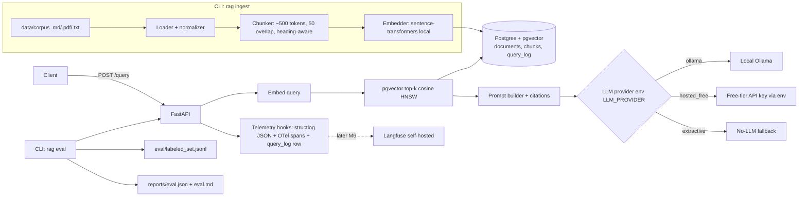

# Spec: rag-production — Production-Style RAG API

> Owner: Raphael Ribeiro · Status: DRAFT (awaiting approval) · Due: **2026-11-30**
> Follow-up deliverable (separate): Langfuse observability & cost dashboards — due **2026-12-15**
> Format: spec-driven-development (Specify phase). Planning/tasks start only after approval.

## Assumptions
1. Stack is fixed by lead: **Python 3.11 + FastAPI + Postgres 16 with pgvector + Docker / docker-compose**.
2. Zero spend: local embeddings (`sentence-transformers/all-MiniLM-L6-v2`, 384-dim) and a local/free LLM (Ollama, e.g. `qwen2.5:1.5b`/`llama3.2:3b`), with an optional free-tier hosted LLM selected via env var. A deterministic `extractive` fallback (no LLM) always works, including in CI.
3. Corpus: a small public, license-clean doc set (e.g. ~50–200 Markdown/PDF pages of open-source docs) committed under `data/corpus/`.
4. Single-tenant, no auth beyond an optional API key from env.

## Objective
Build a portfolio-grade RAG API that demonstrates AI-engineering production practices: reproducible ingestion, vector search on pgvector, grounded answers with citations, **automated quality evaluation gated in CI**, per-query latency/cost logging, structured logs/traces, tests, CI, and a free deploy path. Success = a reviewer can `docker compose up`, ask questions, see cited answers, and read an eval report with published numbers — in under 10 minutes, at $0.

**User stories**
- As a hiring reviewer, I want to run the whole system locally with one command so I can verify it works.
- As a reviewer, I want a quality report (recall@k, hit rate, faithfulness) so I can judge rigor, not demos.
- As the operator, I want each query's latency and estimated cost logged so I can reason about production trade-offs.

## Non-Goals
- Multi-tenant auth/RBAC, UI/frontend (API + OpenAPI docs only).
- Paid APIs or managed vector DBs (Pinecone, OpenAI) — violates zero spend.
- Fine-tuning models; agentic/multi-step tool use.
- **Langfuse integration and dashboards** — separate deliverable (M6, due 2026-12-15); this spec only provides the hooks.
- Kubernetes / autoscaling.

## Tech Stack
FastAPI, Uvicorn, Pydantic v2, SQLAlchemy/psycopg 3, Postgres 16 + `pgvector` (`pgvector/pgvector:pg16` image), sentence-transformers, pypdf, Ollama (optional), structlog, OpenTelemetry SDK (console/OTLP exporter), pytest + pytest-cov + httpx, ruff, mypy, Docker, docker-compose, GitHub Actions.

## Architecture


## API Contract
- `GET /health` → `200 {"status":"ok","db":"ok","model":"<embedder>"}`
- `POST /ingest` (or CLI `rag ingest <path>`) → `{documents, chunks, skipped}`; idempotent by content SHA-256.
- `POST /query` body `{question: str(1..2000), top_k: int=5 (1..20)}` → `{answer, citations:[{chunk_id, doc_id, source, score}], latency_ms:{embed, retrieve, generate, total}, cost_usd, provider, request_id}`
- `GET /metrics` (Prometheus text, optional P1).

## Commands
```
Dev:        docker compose up --build          # api + db (+ ollama profile: --profile llm)
Ingest:     docker compose exec api rag ingest data/corpus
Test:       pytest -q --cov=app --cov-fail-under=80
Lint/type:  ruff check . && ruff format --check . && mypy app
Eval:       rag eval --set eval/labeled_set.jsonl --k 5 --out reports/
```

## Project Structure
```
app/            api/ (routes), ingest/ (loaders, chunker), retrieval/, llm/ (providers), telemetry/, db/ (models, migrations)
eval/           labeled_set.jsonl, metrics.py, runner.py
tests/          unit/, integration/ (docker Postgres), e2e/
data/corpus/    small public corpus
reports/        generated eval outputs (gitignored except a committed baseline)
.github/workflows/ci.yml
docker-compose.yml, Dockerfile, .env.example, README.md
```

## Code Style
ruff (line 100), type hints everywhere, mypy clean, Pydantic models at boundaries, providers behind a Protocol:
```python
class LLMProvider(Protocol):
    name: str

    def generate(self, prompt: str, *, max_tokens: int = 512) -> Generation: ...
```

## Observability & Cost Hooks (this deliverable)
- Every request: structlog JSON line with `request_id, route, question_hash, top_k, provider, latency_ms.{embed,retrieve,generate,total}, tokens_in, tokens_out, cost_usd, status`.
- OTel spans: `query` → `embed`, `retrieve`, `generate` (console exporter by default; OTLP endpoint via env).
- `query_log` table row per query (same fields).
- Cost model: `cost_usd = tokens_in*PRICE_IN + tokens_out*PRICE_OUT` from env/config; local/extractive = 0.0.
- A single `TelemetrySink` interface so Langfuse (M6) plugs in without touching route code.

## Testing Strategy
- Unit: chunker, cost calc, metrics (recall@k, hit rate), prompt builder, provider selection.
- Integration: real Postgres+pgvector via docker service in CI; ingest → query round trip.
- Eval as test: `tests/e2e/test_eval_gate.py` fails if metrics fall below thresholds.
- Coverage ≥ 80% on `app/`.

## Milestones (rough effort, ~1 person part-time)
| # | Milestone | Effort | Target date |
|---|---|---|---|
| M0 | Repo skeleton, docker-compose (api + pgvector), CI lint/test stub, `.env.example` | 0.5 d | Nov 3 |
| M1 | Ingestion + chunking + embeddings into pgvector (HNSW index), idempotency | 1.5 d | Nov 8 |
| M2 | `/query` retrieval + providers (extractive, Ollama, hosted_free) + citations | 2 d | Nov 14 |
| M3 | Labeled eval set (≥30 Qs) + eval runner + CI quality gate | 2 d | Nov 20 |
| M4 | Telemetry hooks: structlog, OTel spans, `query_log`, cost model | 1 d | Nov 24 |
| M5 | Free-tier deploy option docs + README, baseline report, polish | 1 d | **Nov 30** |
| M6 (later) | **Langfuse self-hosted integration** (traces, cost/latency dashboards) — separate deliverable | 1.5 d | **Dec 15** |

## Acceptance Criteria (each measurable)
**Setup / reproducibility**
- [ ] AC1 `docker compose up --build` on a clean machine reaches healthy state; `GET /health` returns 200 within 120 s (excluding image download).
- [ ] AC2 No paid service required: full test + eval suite passes with `LLM_PROVIDER=extractive` and no network keys set.
- [ ] AC3 `gitleaks detect` (CI step) reports 0 findings; all config read from env; `.env.example` lists every variable; `.env` is gitignored.

**Ingestion & chunking**
- [ ] AC4 Ingesting `data/corpus/` supports `.md`, `.txt`, `.pdf`; a test asserts chunk count > 0 for each type.
- [ ] AC5 Chunks are ≤ 512 tokens (embedder tokenizer) with configured overlap; unit test verifies on fixture docs.
- [ ] AC6 Re-ingesting the same corpus adds 0 new rows (idempotent by SHA-256).
- [ ] AC7 Ingesting the reference corpus completes in ≤ 5 min on a 4-core CPU laptop.

**Retrieval & API**
- [ ] AC8 Vectors stored in pgvector `vector(384)` with an HNSW cosine index (migration test checks index exists).
- [ ] AC9 `POST /query` returns schema-valid JSON (Pydantic) with ≥ 1 citation whose `chunk_id` exists in DB.
- [ ] AC10 Invalid input (empty question, `top_k`>20) returns 422; DB down returns 503 with JSON error — both tested.
- [ ] AC11 Retrieval latency p95 ≤ 150 ms over 100 eval queries (local Docker, CPU); end-to-end p95 with `extractive` ≤ 500 ms. Reported in `reports/eval.md`.

**Quality evaluation**
- [ ] AC12 `eval/labeled_set.jsonl` has ≥ 30 items, each with `question`, `relevant_doc_ids`/chunk ids, `reference_answer`.
- [ ] AC13 `rag eval` outputs `reports/eval.json` with hit_rate@5, recall@5, MRR, faithfulness, latency p50/p95.
- [ ] AC14 CI gate: hit_rate@5 ≥ 0.80 and recall@5 ≥ 0.70; build fails below thresholds (proven by a test that injects a degraded retriever).
- [ ] AC15 Faithfulness ≥ 0.85 measured as fraction of answer sentences supported by cited chunks (NLI cross-encoder `cross-encoder/nli-deberta-v3-small` or token-overlap fallback ≥ 0.5), method documented.
- [ ] AC16 Questions with no relevant context (≥ 5 negative items) return an "I don't know" answer in ≥ 80% of cases.

**Cost, latency, observability hooks**
- [ ] AC17 Every `/query` emits exactly one JSON log line containing all fields listed in "Observability & Cost Hooks"; test captures and validates it.
- [ ] AC18 Every `/query` writes one `query_log` row; `cost_usd` = 0.0 for local providers and matches the formula (±1e-9) for priced providers in unit tests.
- [ ] AC19 OTel span tree `query → {embed, retrieve, generate}` emitted (in-memory exporter test); `request_id` returned in response and `X-Request-ID` header.
- [ ] AC20 `TelemetrySink` interface exists with a no-op and a log sink; adding a sink requires no route changes (Langfuse sink deferred to M6).

**Testing & CI**
- [ ] AC21 `pytest` passes with coverage ≥ 80% on `app/`.
- [ ] AC22 GitHub Actions on push/PR runs: ruff, mypy, pytest (with pgvector service container), eval gate, gitleaks, docker build — total ≤ 15 min, free runners only, model cache enabled.

**Deploy & docs**
- [ ] AC23 README documents one free deploy option (e.g. Render/Koyeb/Fly free tier or HF Spaces Docker + free Postgres with pgvector such as Neon/Supabase free tier) with step list; deployment is optional and not performed by this task.
- [ ] AC24 README includes architecture diagram, quickstart (≤ 5 commands), baseline eval table, and known limitations.

## Boundaries
- Always: env vars for config, run tests + eval before merging, keep corpus license-clean.
- Ask first: adding paid services, changing the fixed stack, changing eval thresholds.
- Never: commit secrets or `.env`, call paid APIs by default, weaken eval gates to make CI pass.

## Risks & Mitigations
| Risk | Impact | Mitigation |
|---|---|---|
| Local LLM too slow/heavy on CI runners | CI timeouts | CI uses `extractive` provider; Ollama only in local profile |
| Model downloads slow CI | > 15 min builds | Cache HF models in Actions cache; small models |
| Small labeled set → noisy metrics | Misleading claims | ≥ 30 items + negatives; report confidence and set size |
| Faithfulness metric is approximate | Over-claimed quality | Document method; spot-check 10 answers manually |
| Free-tier hosts change limits / cold starts | Demo breaks | Local docker-compose is the primary demo; deploy is optional |
| Free Postgres hosts lacking pgvector | Deploy blocked | Pick provider with pgvector (Neon/Supabase) |
| Scope creep into Langfuse before Nov 30 | Miss deadline | Langfuse explicitly M6 (Dec 15); only hooks now |

## Open Questions
1. Which corpus? (Raphael) — proposed: FastAPI or PostgreSQL docs subset.
2. Which free hosted LLM, if any, as secondary provider? (Raphael) — optional.
3. Are eval thresholds (0.80 / 0.70 / 0.85) acceptable to the lead? (lead)

## Addendum (2026-10-22, lead review)
- AC25: README publishes a measured comparison table: BM25 keyword vs. vector vs. hybrid + reranking (hit rate@5, recall@5, faithfulness, p95 latency, cost/query), same eval set.
- AC26: Dedicated test with questions not answerable from the corpus; API must refuse ("I don't know" + no fabricated citation). Build fails on any fabricated answer in this set.
- Corpus: **DECIDED 2026-10-22: FastAPI docs (MIT, https://github.com/fastapi/fastapi).** Resolves open question 1.
- Faithfulness (AC15): **DECIDED 2026-10-22: CI gate ≥ 0.85, scored by the local NLI cross-encoder (free, deterministic). LLM judge is offline-only and reported in the README, never gating.**
- Thresholds above approved by lead for v1.
